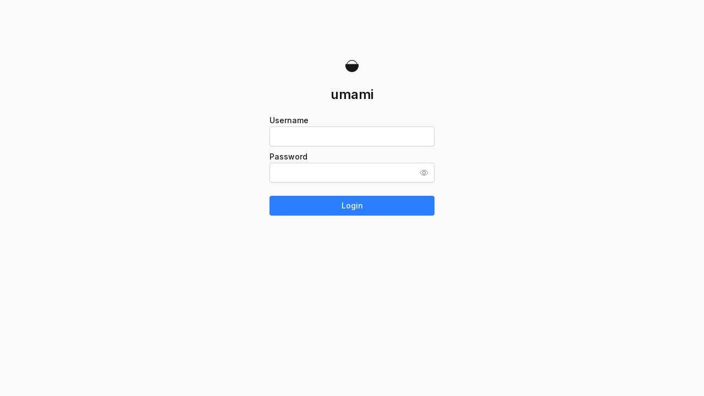

# Airlock QA report: umami-software/umami@559e3c6

**Result:** SUCCESS (DONE) · **gate:** passed

| | |
| :--- | :--- |
| Run | `run_qa_4d138e11684f45bb` |
| Repository | https://github.com/umami-software/umami |
| Commit | `559e3c607c23d2c72d9bd4f6481bda428255323c` |
| Branch | `master` |
| Gate mode | default |
| Started | 2026-11-08T10:19:26.717Z |
| Finished | 2026-11-08T10:23:33.820Z |
| Screenshots | 1 |

## Suites

| Suite | Result |
| :--- | :--- |
| smoke | PASS |
| explore | PASS |

## Findings

| Severity | Finding | Route | Seen by |
| :--- | :--- | :--- | :--- |
| S3 | missing Strict-Transport-Security header ([screenshot](#screenshots)) `missing_security_header` | `/` | Airlock checker |

## Screenshots

### screenshot-1.jpg — / (finding on this page)

## Reasons

- explore: checker visited 1 pages, clicked 2 controls, blocked 0 data-changing requests

## What this means

This report records what the run stored. A failed gate means the requested suites did not all pass; it is not a statement that the application is secure or compliant. Findings marked “Airlock checker” were seen by Airlock from its own container; findings marked “Your tests” come from the repository’s own test output and are self-reported.

The sealed result was verified with the service’s published Ed25519 key.

---

Generated by [AirlockQA](https://qbrin.cloud) for run `run_qa_4d138e11684f45bb`.
